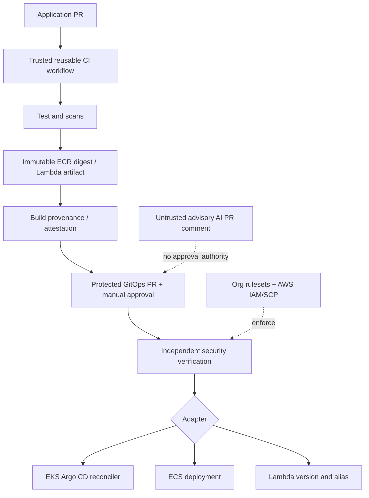

# AWS Reusable CI/CD Platform — reference architecture

> **Status: reference implementation, not production validated.** No AWS account, GitHub Enterprise rulesets or Scalr workspace was available for end-to-end validation.

Central workflow orchestration with **EKS/Argo CD, ECS Fargate, Lambda** adapters, immutable release manifest, OIDC, protected promotion, deterministic policy, and advisory-only AI review.

## Architecture



## Threat model and trust boundaries

* Application maintainers can modify callers and application code; **cannot** alone modify organization rulesets, protected environments, reusable workflow release refs, deploy IAM roles or policy bundles.
* **Caller workflow is not a security boundary.** Organization rulesets, required workflows/checks, GitHub environment protection, protected deployment repositories, and AWS permissions must be administered outside application repositories.
* OIDC trust binds repo and protected environment; require additional repository workflow controls, restricted `job_workflow_ref` claim where supported and tested, and IAM role permissions restricted to the required deployment resources. Never trust a self-declared `environment` or repository input by itself.
* **Attestation creation alone is not verification.** Independently verify artifact identity, provenance and digest before deployment. See `docs/SECURITY.md` for production gate requirements.
* LLM analysis is advisory, untrusted, receives redacted non-secret metadata only, has read-only token and no authority to merge, approve or deploy.
* Admins and break-glass principals remain privileged: separation of duties, audit, MFA, and external monitoring required.

## Repository structure

- `.github/workflows/reusable-ci.yml`: reusable test/build entrypoint
- `.github/workflows/reusable-deploy.yml`: guarded adapter dispatcher (reference only)
- `.github/workflows/advisory-review.yml`: AI review comment pattern (disabled by default)
- `scripts/validate_release.py`: strict release contract validator
- `scripts/verify_release.py`: deterministic verification of signed manifest contract (illustrative, not complete provenance verifier)
- `policies/release.rego`: OPA policy sample
- `examples/consumer/.github/workflows/ci.yml`: SHA-pinned caller example (placeholder SHA must be replaced)
- `examples/release.json`: release manifest example
- `docs/`: threat model, deployment adapters, ADRs and operational runbook

## Quick start (offline)

```bash
python3 -m unittest discover -s tests -v
python3 scripts/validate_release.py examples/release.json
# optional: opa test policies -v
```

## Production prerequisites (not configured here)

1. GitHub organization rulesets, CODEOWNERS, protected tags/branches, required independent checks, two-person approval, environment deployment restrictions and no self-review.
2. AWS Organizations OU structure: Security, Infrastructure/Platform, Shared Services, Workload Product A/B with distinct prod/nonprod accounts; SCP and IAM restrictions.
3. ECR repositories and trusted OIDC provider; account-scoped deploy roles; KMS, audit logs, CloudTrail and artifact registry.
4. A security-owned deployment verification service/runner that checks trusted provenance, policy decision, GitOps commit and artifact digest independently from the app repo.
5. Trusted pinned workflow release SHA; replace all `REPLACE_*` placeholders and verify API/tool support before enabling deployment.

## Demo story for interviews

Explain why generic build and policy gates are centralized, while runtime-specific deploy adapters are separate. Walk through a malicious PR trying to skip scanning or replace the digest: org-enforced checks and independent AWS-side deploy authorization must reject it. The sample YAML is a starting point, **not evidence those protections have been installed**.
